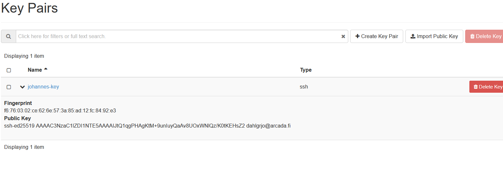
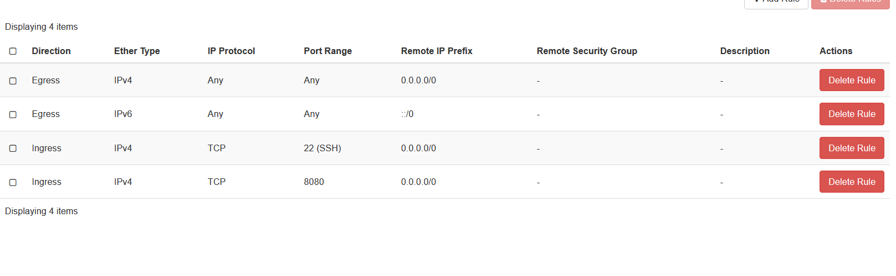
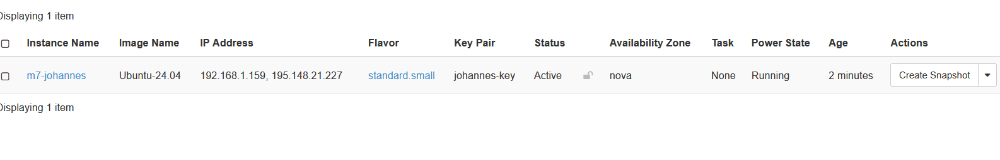
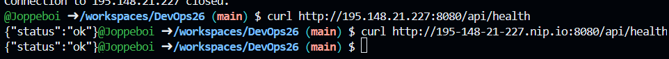
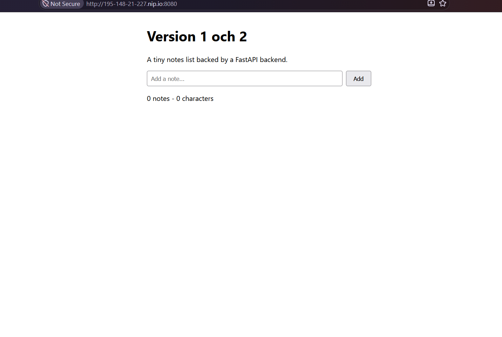

# M7 – VM i cPouta för hand

## 1. Key pair

Jag skapade ett ed25519-nyckelpar i min codespace och importerade bara den publika nyckeln till cPouta via Import Public Key. Den privata nyckeln stannar hos mig och är skyddad med en lösenfras. Fingeravtrycket i listan visar vilken nyckel som är min.

## 2. Security group

Jag skapade security groupen m7-app med två Ingress-regler: port 22 för SSH och port 8080 för appen, båda öppna från 0.0.0.0/0. Utan dem blockerar cPouta all inkommande trafik till VM:en.

## 3. Instans och floating IP

Instansen m7-johannes kör Ubuntu-24.04 på flavorn standard.small, med m7-app och min nyckel vald. Den interna adressen går bara att nå inifrån CSC:s nät, så jag kopplade en floating IP från poolen PUBLIC för att den ska nås utifrån.

## 4. SSH och docker-compose.yml på VM:en
Jag loggade in som användaren med ssh och installerade Docker med get.docker.com-skriptet. Compose-filen ligger i /opt/app/docker-compose.yml och kör backend och frontend från GHCR, där frontend publiceras på port 8080.

## 5. Curl utifrån och appen via nip.io

Från min codespace svarar `curl` med {"status":"ok"}. Ett test mot localhost på VM:en går förbi security groupen, så bara ett anrop utifrån visar att floating IP:n och reglerna fungerar. nip.io gör om IP:n till ett värdnamn genom att punkterna byts mot bindestreck, och notes appen syns i webbläsaren på den adressen.

## 6. Appen via nip.io i webbläsaren
