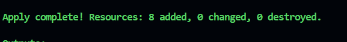
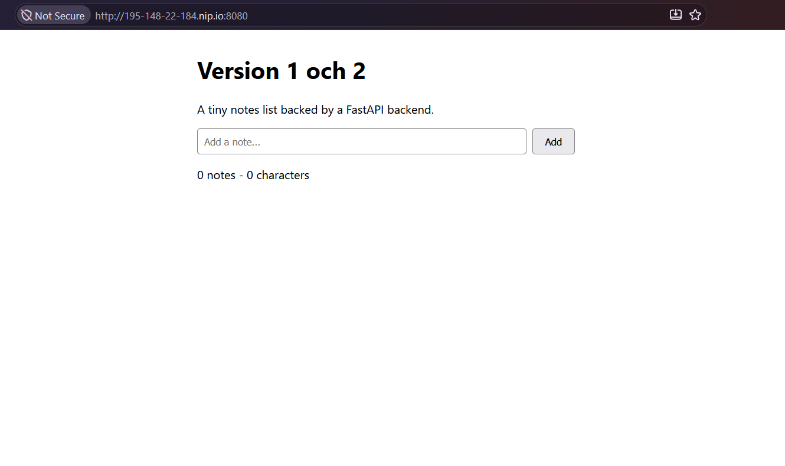
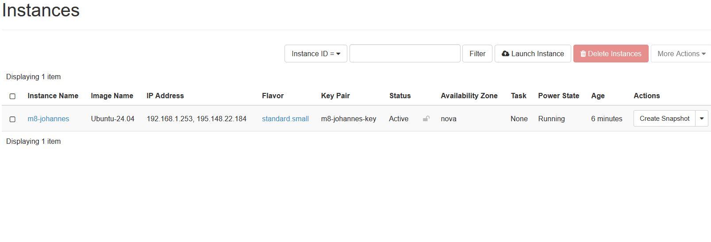
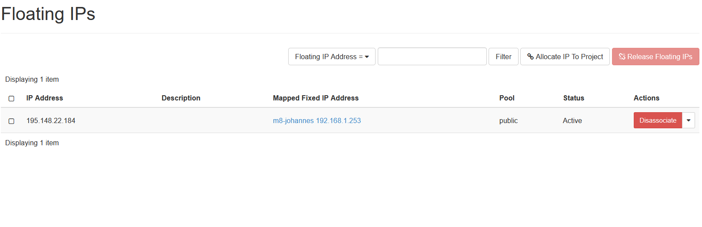
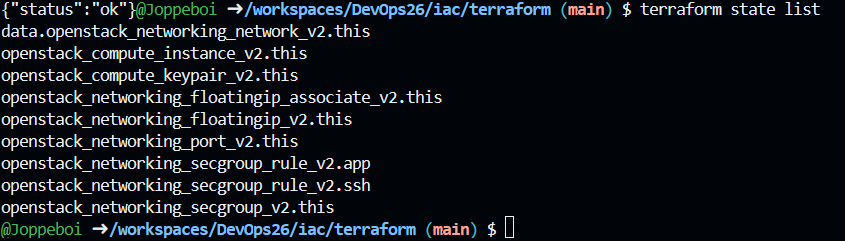
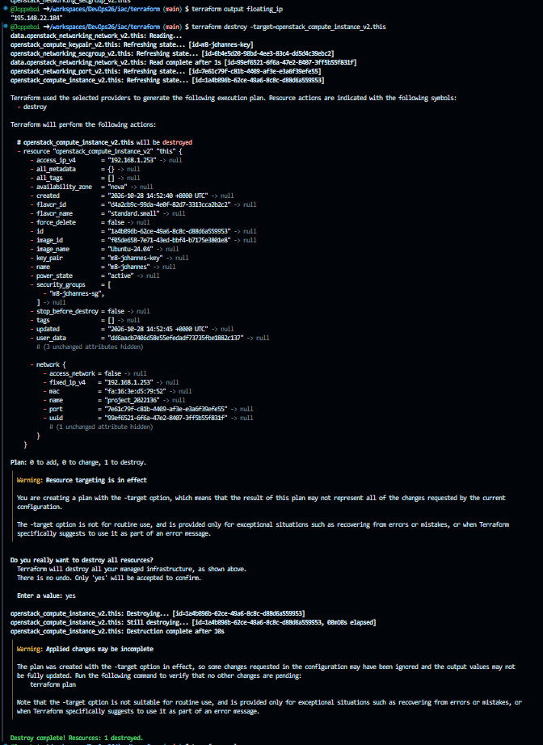
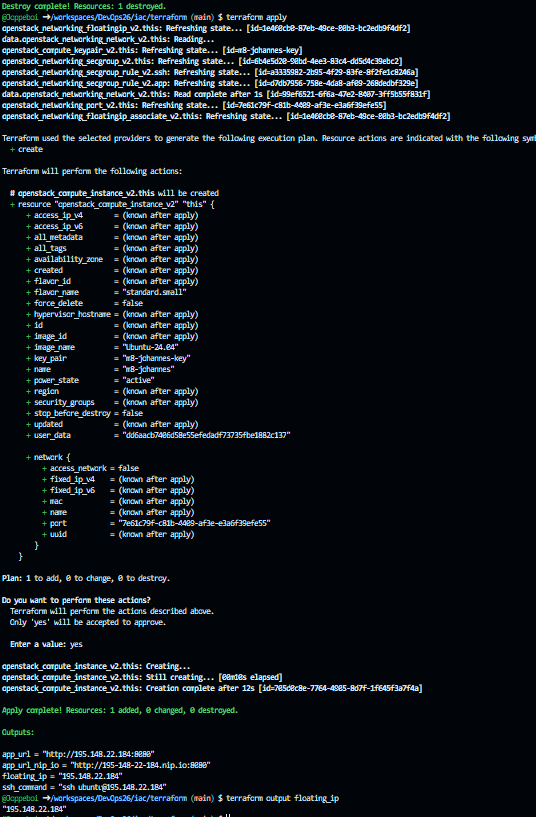

# M8 Terraform återskapar M7

## 1. terraform apply

Jag skapade en application credential med rollen member och lade clouds.yaml i hemkatalogen, utanför repot. Efter att jag fyllt i terraform.tfvars körde jag init, plan och apply. Terraform skapade åtta resurser: samma sex som jag klickade fram i M7 plus nätverksporten och associationen mellan floating IP och port.

## 2. Appen via nip.io

Efter ett par minuter hade cloud-init installerat Docker och startat båda containrarna. Det jag gjorde för hand i M7 steg 8 och 9 sker nu automatiskt när VM:en startar första gången. Appen visas på M8:s egen nip.io-adress.

## 3. M7 riven

Jag raderade den handbyggda m7-johannes och släppte dess floating IP i Horizon. Nu finns bara m8-johannes och dess adress kvar, vilket frigör kvot i projektet. Terraforms resurser påverkades inte eftersom M7 aldrig fanns i staten.

## 4. terraform state list

state list visar de åtta resurserna Terraform bokför plus en datarad för nätverket som bara läses. Staten sparas lokalt i codespacen och committas aldrig.

## 5. Rebuild: samma floating IP

Jag rev bara instansen med destroy -target och körde apply igen. Floating IP:n och porten är egna resurser som inte rördes, så den nya VM:en fick exakt samma adress och appen svarade på samma URL.
