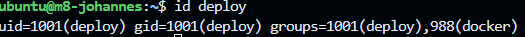
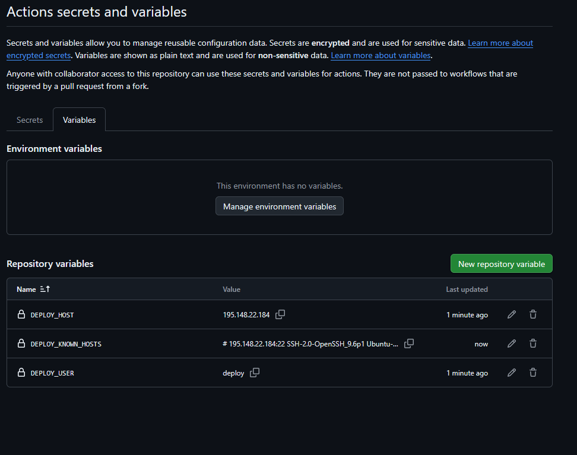
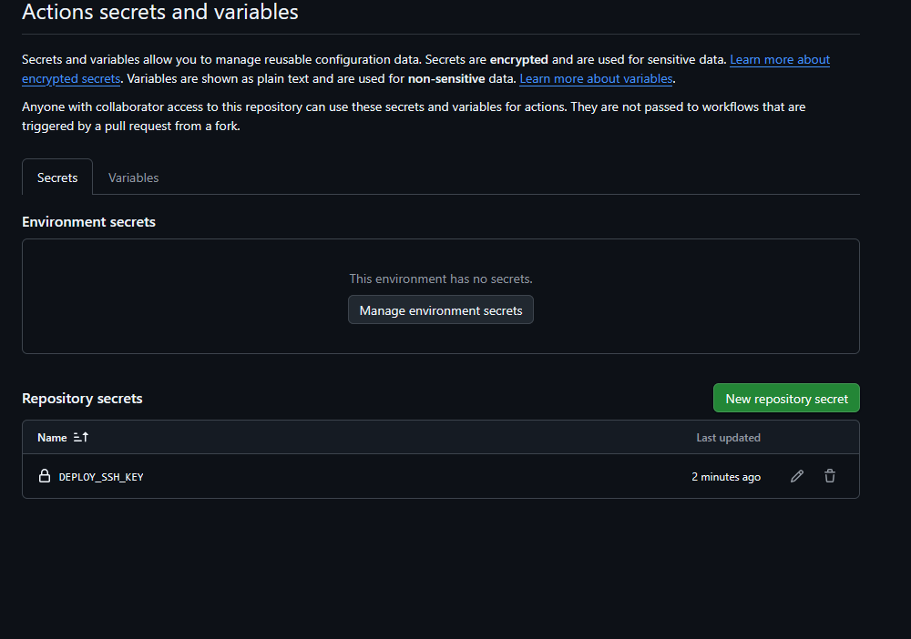
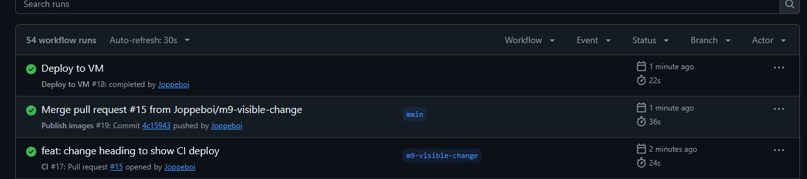
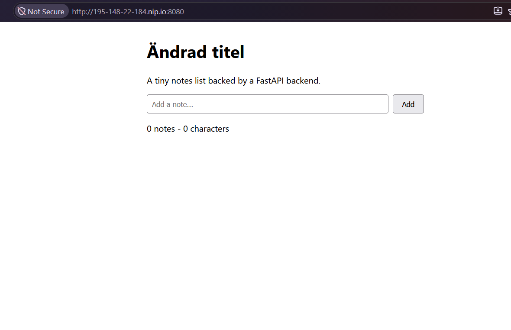

# M9 CD hela kedjan

## 1. Deploy användaren på VM:en

Jag skapade en ny dedikerad deploy nyckel och en egen användare deploy på VM:en. Användaren är med i docker gruppen så att den kan köra docker compose utan sudo, och bara den publika nyckeln ligger i dess authorized_keys. Innan CI fick nyckeln testade jag den manuellt med docker compose ps över SSH.

## 2. Secrets och variabler i GitHub

DEPLOY_SSH_KEY är den privata nyckeln och ligger som secret eftersom den ger åtkomst till VM:en. DEPLOY_USER, DEPLOY_HOST och DEPLOY_KNOWN_HOSTS är offentlig information och ligger som variabler. Host nyckeln från ssh-keyscan är pinnad i förväg så att Actions vet vilken server den ansluter till.

## 3. Kedjan i Actions

När min PR mergades till main startade Publish images och byggde nya images. Först när den blivit grön startade Deploy to VM via workflow_run, loggade in som deploy och körde pull och up -d. Testerna körs redan på PR:en, så otestad kod når aldrig main.

## 4. Ändringen live

Den nya rubriken syns på http://195-148-22-184.nip.io:8080/ utan att jag loggat in på VM:en under deployen, och /api/health svarar {"status":"ok"}.